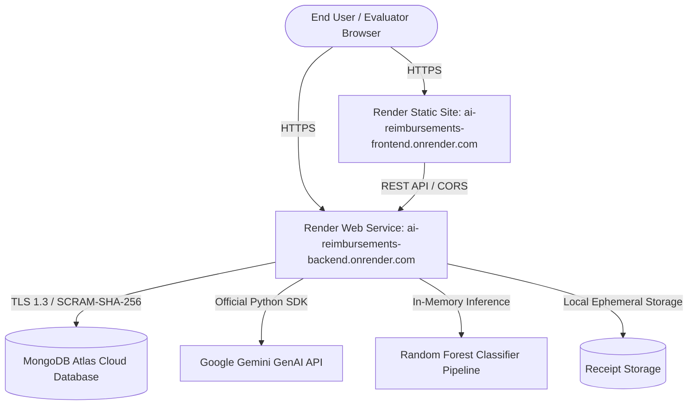

# AI-Enhanced Reimbursements Management System — Deployment Guide

This guide details the complete production hosting architecture, configuration steps, environment variables, redeployment workflows, and verification procedures for the **AI-Enhanced Reimbursements Management System**.

---

## 1. Production Hosting Architecture



- **Frontend**: Render Static Site (`ai-reimbursements-frontend.onrender.com`) serving high-contrast corporate HTML5, modern CSS3, and JavaScript modules from the `./frontend` directory.
- **Backend**: Render Web Service (`ai-reimbursements-backend.onrender.com`) running Python 3.11 with Gunicorn WSGI (`gunicorn run:app --bind 0.0.0.0:$PORT --workers 2 --threads 4 --timeout 120`). Also serves static assets natively as an integrated backup.
- **Database**: MongoDB Atlas multi-region cluster (`cluster0.gse3wum.mongodb.net`), secured with SCRAM-SHA-256 and TLS encryption.
- **GenAI Copilot**: Google Gemini Flash API (`gemini-3.5-flash` / `gemini-1.5-flash`) providing structured compliance audits, expense summaries, missing documentation checks, and actionable review suggestions.
- **Machine Learning**: Pre-trained Random Forest Classifier (`random_forest_reimbursement.joblib`) calculating multidimensional approval risk probabilities and confidence scores.

---

## 2. Public URLs & Endpoints

| Resource | Public URL | Description |
|---|---|---|
| **Frontend Portal** | [https://ai-reimbursements-frontend.onrender.com/](https://ai-reimbursements-frontend.onrender.com/) | Primary user interface for Employees & Finance Admins |
| **Backend Root** | [https://ai-reimbursements-backend.onrender.com/](https://ai-reimbursements-backend.onrender.com/) | Integrated API & static web service fallback |
| **Health Check** | [https://ai-reimbursements-backend.onrender.com/api/health](https://ai-reimbursements-backend.onrender.com/api/health) | High-availability container liveness & readiness endpoint |
| **GitHub Repository** | [https://github.com/MahaManisha/AI-Enhanced-Reimbursements-Management-System](https://github.com/MahaManisha/AI-Enhanced-Reimbursements-Management-System) | Connected source repository with automated CD |

---

## 3. Environment Variables Reference

Configure these environment variables in the Render Dashboard (**Environment** tab of the Web Service):

| Variable Name | Required | Default / Recommended | Purpose |
|---|---|---|---|
| `FLASK_ENV` | Yes | `production` | Enables production optimizations and disables debug traces |
| `DEBUG` | Yes | `False` | Disables Werkzeug debug server mode in production |
| `PORT` | Auto | `10000` | Automatically injected by Render for binding Gunicorn |
| `SECRET_KEY` | Yes | *(32+ char random string)* | Cryptographic key for session cookies |
| `JWT_SECRET_KEY` | Yes | *(32+ char random string)* | Cryptographic signing key for HS256 JWT tokens |
| `JWT_ACCESS_TOKEN_EXPIRES_HOURS` | No | `24` | Token lifespan in hours |
| `MONGO_URI` | Yes | *(Atlas connection string)* | MongoDB Atlas SRV URI with user credentials |
| `MONGO_DB_NAME` | Yes | `reimbursement_db` | Primary application database name |
| `LLM_PROVIDER` | Yes | `gemini` | Generative AI provider (`gemini` or `fallback`) |
| `GEMINI_API_KEY` | Yes | *(Google AI Studio Key)* | Secret API key for Google GenAI |
| `GEMINI_MODEL` | No | `gemini-1.5-flash` | Candidate models: `gemini-1.5-flash`, `gemini-3.5-flash` |
| `FRONTEND_URL` | No | `*` or frontend domain | Allowed CORS origins for API requests |

> [!CAUTION]
> Never commit `.env` files or hardcode passwords, database URIs, or API keys into git or frontend scripts. All credentials must be managed strictly through Render's secret environment variables dashboard.

---

## 4. Database Setup & Network Configuration

1. **MongoDB Atlas Cluster**:
   - Provisioned on MongoDB Atlas (`cluster0.gse3wum.mongodb.net`).
   - Standard collections: `users`, `categories`, `reimbursements`, `audit_logs`.
   - Indexes automatically initialized upon backend startup by `app.db.init_db()`.

2. **Network Access Rule**:
   - In MongoDB Atlas, go to **Security** &rarr; **Network Access**.
   - Add rule **`0.0.0.0/0`** (*Allow Access from Anywhere*).
   - *Rationale*: Render services operate on dynamic cloud IP pools; enabling `0.0.0.0/0` ensures container instances can connect without disruption while remaining protected by database-level authentication and TLS 1.3 encryption.

---

## 5. Deployment Step-by-Step

### A. Backend Web Service (`ai-reimbursements-backend`)
1. In Render Dashboard, click **New +** &rarr; **Web Service**.
2. Connect `MahaManisha/AI-Enhanced-Reimbursements-Management-System`.
3. Set **Runtime** to `Python 3`.
4. Configure **Build Command**:
   ```bash
   pip install -r requirements.txt
   ```
5. Configure **Start Command**:
   ```bash
   gunicorn run:app --bind 0.0.0.0:$PORT --workers 2 --threads 4 --timeout 120
   ```
6. Add Environment Variables: `MONGO_URI`, `GEMINI_API_KEY`, `FLASK_ENV`, `JWT_SECRET_KEY`, etc.
7. Click **Create Web Service**.

### B. Frontend Static Site (`ai-reimbursements-frontend`)
1. In Render Dashboard, click **New +** &rarr; **Static Site**.
2. Connect `MahaManisha/AI-Enhanced-Reimbursements-Management-System`.
3. Set **Publish Directory** to `frontend`.
4. Leave **Build Command** blank.
5. Click **Create Static Site**.

---

## 6. Continuous Deployment & Redeployment

Both services have **Auto-Deploy** enabled on branch `main`:
1. Make your code or asset edits locally.
2. Commit and push to GitHub:
   ```bash
   git add .
   git commit -m "Your update message"
   git push origin main
   ```
3. Render automatically detects the push and triggers an automated rolling build without downtime.
4. To trigger a manual redeploy without code changes:
   - Go to service dashboard &rarr; click **Manual Deploy** &rarr; **Clear build cache & deploy**.

---

## 7. Production Testing & Demonstration Accounts

Use these pre-seeded demonstration accounts for college presentations and evaluator reviews:

| Role | Email | Password | Allowed Capabilities |
|---|---|---|---|
| **Finance Admin** | `admin@company.com` | `Password@123` | Review claims, view AI dossiers, authorize approval/rejection, audit logs, analytics |
| **Employee** | `john.doe@company.com` | `Password@123` | Submit claims, upload receipts, inspect ML probabilities & AI observations |

---

## 8. Known Limitations & Architecture Notes

1. **Render Free-Tier Spin-Down**:
   - Inactive free-tier web services spin down after 15 minutes of inactivity. The first incoming request after idle may experience a ~40-second cold-start delay while the container launches.
2. **Ephemeral File Storage**:
   - Render's free tier provides ephemeral local disk storage. Uploaded receipt files in `uploads/` persist across requests during container life, but reset when the service undergoes a fresh deployment or reboot. For multi-tenant production systems, an AWS S3 or Cloudinary storage bucket can be configured as an external persistence target.
