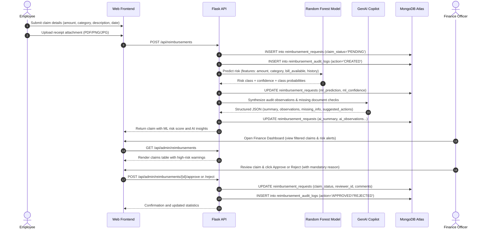
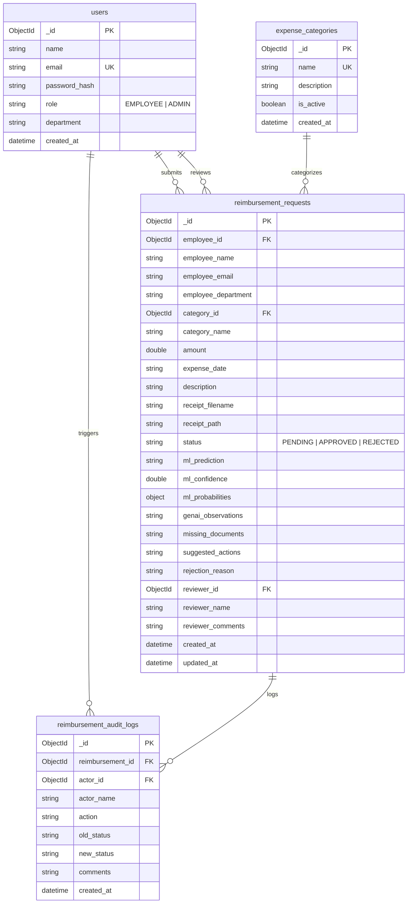

# AI-Enhanced Reimbursements Management System
## Comprehensive Technical Project Documentation & System Design

**College Project Evaluation Deliverable**  
**Academic Year:** 2026–2027  
**Technology Stack:** Python 3.13, Flask, MongoDB Atlas (PyMongo), scikit-learn, Chart.js, HTML5/CSS3/Vanilla JS  

---

## 1. Executive Summary & Problem Statement

Corporate reimbursement systems frequently suffer from major procedural bottlenecks:
1. **Prolonged Verification Cycles:** Finance personnel manually review hundreds of recurring receipts, leading to delays and employee dissatisfaction.
2. **Fraud & Policy Non-Compliance:** Unsubstantiated claims, missing invoices, and weekend expenditures frequently pass through due to audit fatigue.
3. **Rigid Rule Engines:** Traditional regex/threshold systems either produce overwhelming false alarms or miss nuanced patterns.

The **AI-Enhanced Reimbursements Management System** solves these challenges by combining:
- A **Random Forest Classifier** trained on policy metadata and historical compliance to predict approval risk (`LIKELY_APPROVED`, `REQUIRES_REVIEW`, `HIGH_REJECTION_RISK`) with statistical confidence scores.
- A **Generative AI Copilot** (configurable LLM API) providing structured audit summaries, policy compliance observations, missing documentation checklists, and actionable recommendations.
- A **Zero-Leakage Architecture**: Predictions strictly utilize metadata available at submission time. Final approval authority remains exclusively with authorized human finance personnel.

---

## 2. System Architecture

The application adopts a clean, layered 3-tier architecture:

```
[ Frontend: HTML5 / CSS3 / Vanilla JS / Chart.js ]
                         |
                   REST API (JWT)
                         |
      [ Backend Application Layer: Flask REST API ]
     /                   |                         \
    v                    v                          v
[ MongoDB Atlas ]   [ Random Forest Pipeline ]   [ GenAI Copilot Service ]
(PyMongo Driver)       (joblib Classifier)         (LLM API / Heuristics)
```

### End-to-End Reimbursement Workflow Sequence



---

## 3. Database Schema Design (MongoDB Atlas)

The database layer utilizes **MongoDB Atlas** (`reimbursement_db`) with optimized BSON document models, unique constraint indexes, and single-field search indexes for high-throughput queries:

### MongoDB Collections & Document Schemas



### Collection Indexes

1. **`users`**:
   - `_id`: Default primary index
   - `email`: Ascending unique index (`unique=True`) for instantaneous authentication lookups and duplicate email prevention
2. **`expense_categories`**:
   - `_id`: Default primary index
   - `name`: Ascending unique index (`unique=True`) preventing duplicate category nomenclature
3. **`reimbursement_requests`**:
   - `_id`: Default primary index
   - `employee_id`: Ascending index for rapid retrieval of employee-specific claims
   - `status`: Ascending index for filtering review queues and status metrics
   - `created_at`: Ascending index for historical auditing and chronological timelines
4. **`reimbursement_audit_logs`**:
   - `_id`: Default primary index
   - `reimbursement_id`: Ascending index for fast claim audit trail reconstruction

---

## 4. Machine Learning Module

### Task Definition
Predict reimbursement approval risk category:
- `LIKELY_APPROVED`: Low risk, conforms to historical precedent and receipts.
- `REQUIRES_REVIEW`: Borderline expenditure, requiring closer departmental inspection.
- `HIGH_REJECTION_RISK`: High probability of non-compliance (missing receipts on high sums, policy limit overruns, high past employee rejection frequency).

### Input Features (Zero Data Leakage)
1. `amount` (float): Value in USD.
2. `category_name` (string): Categorical expense bucket.
3. `day_of_week` (int, 0–6): Derived strictly from `expense_date`.
4. `bill_available` (binary, 0 or 1): Presence of attached receipt document.
5. `employee_total_past_claims` (int): Number of finalized historical claims by this employee.
6. `employee_past_approval_rate` (float, 0.0 to 1.0): Past approved claims / total past claims.
7. `employee_past_rejection_count` (int): Prior historical rejections.
8. `amount_to_category_median_ratio` (float): Ratio of claim amount relative to corporate median.

*Guarantee:* Features are strictly derived before any human review decision. Current claim status is **never** fed as an input feature.

### Model Architecture & Training
- **Pipeline:** `ColumnTransformer(StandardScaler, OneHotEncoder)` + `RandomForestClassifier(n_estimators=150, max_depth=10, class_weight='balanced', random_state=42)`.
- **Addressing Class Imbalance:** Weighted loss penalizes mistakes on minority classes (`HIGH_REJECTION_RISK`).
- **Validation:** Stratified 80/20 train/test split.
- **Evaluation Results:**
  - Overall Accuracy: **95.20%**
  - `LIKELY_APPROVED`: Precision 0.99, Recall 0.97, F1 0.98
  - `REQUIRES_REVIEW`: Precision 0.78, Recall 0.89, F1 0.83
  - `HIGH_REJECTION_RISK`: Precision 0.95, Recall 0.82, F1 0.88

---

## 5. Generative AI Module

### Architectural Safeguards
1. **Advisory Role Only:** System prompts explicitly prohibit the LLM from executing or asserting final approval decisions.
2. **Prompt Injection Hardening:** Employee description inputs are wrapped as untrusted text strings; instructions inside user descriptions are disregarded.
3. **Structured Schema Validation:** Responses are validated to ensure four core fields are populated (`summary`, `observations`, `missing_info`, `suggested_actions`).
4. **Heuristic Fallback Engine:** If external API keys are unavailable, network fails, or token quotas expire, the service gracefully switches to a rule-based audit engine, guaranteeing zero downtime.

---

## 6. Security & Access Control

- **Password Hashing:** `werkzeug.security.generate_password_hash` using modern `scrypt` key derivation.
- **Authentication & Authorization:** Statelessly signed JWT tokens with 24-hour expiration.
- **Role-Based Access Control (RBAC):**
  - Employees can only query, modify, or view receipts for their own submissions.
  - Endpoints under `/api/admin/*` reject non-admin users with HTTP 403 Forbidden.
- **File Upload Protection:**
  - Extension whitelist: `.pdf`, `.png`, `.jpg`, `.jpeg`.
  - Cryptographically random UUID server-side filenames (`uuid.uuid4().hex`).
  - Magic byte MIME header verification to prevent disguised executable uploads.
  - Path traversal defense preventing directory escape (`Path.relative_to`).
  - Uploads stored in dedicated `uploads/` folder outside web-accessible static roots.

---

## 7. Verification & Automated Test Suite

A complete test suite of **30 test cases** covers all critical functional boundaries:

| Test Module | Coverage Scope | Status |
| :--- | :--- | :--- |
| `tests/test_auth.py` | Registration, login, password hashing, JWT decoding, duplicate email rejection, validation errors | 9/9 PASSED |
| `tests/test_permissions.py` | Role-based access control, unauthenticated rejection, employee access blocks to admin routes and peers' claims | 5/5 PASSED |
| `tests/test_reimbursements.py` | Claim creation, negative amounts, future dates, short descriptions, PDF/PNG upload, malicious file blocking, approval & rejection workflows | 8/8 PASSED |
| `tests/test_prediction.py` | Model persistence, feature calculation, low risk inference, high risk inference, probability distributions | 4/4 PASSED |
| `tests/test_genai.py` | Prompt construction, JSON schema validation, mocked external LLM, heuristic fallback engine | 4/4 PASSED |
| **Total** | **End-to-End Application Integrity** | **30/30 PASSED (100%)** |

